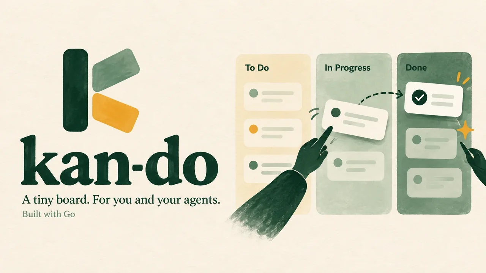

<p align="center">
  
</p>

kan-do is a kanban board for you and your coding agents. You use the board in your browser. Your agents use the same board through MCP. It's one small program, and the whole board lives in one folder on your machine. You don't need an account or a server.

## Install

On macOS or Linux:

```sh
curl -fsSL https://github.com/azmainadel/kan-do/releases/latest/download/install.sh | sh
```

This puts `kando` in `~/.local/bin`. Set `KANDO_INSTALL_DIR` to install it somewhere else, or `KANDO_VERSION` to pick a version.

To update later, run `kando update`.

## Run

```sh
kando
```

The board opens at http://localhost:4242. Your data is kept in `~/kando`.

To start the board every time you log in:

```sh
kando service install
```

## Connect an agent

For Claude Code:

```sh
claude mcp add kando --scope user -- kando mcp
```

Other agents work the same way: run `kando mcp` as a stdio MCP server. If your agent can only reach MCP over HTTP, use `http://localhost:4242/mcp`.

When an agent runs inside a git repo, kan-do picks the project linked to that repo. Agents can list, create and update tasks, take the next one, and leave comments. Changes show up on the board right away.

## Sync between machines

kan-do can keep your board in a private git repo, so every machine has the same board.

1. Create an empty private repo, for example `you/kando-data`.
2. Press the sync button on the board and paste the repo URL, or run:

   ```sh
   kando sync --repo you/kando-data
   ```

3. Do the same on your other machines.

After that, press sync or run `kando sync` to pull and push changes. If both machines changed the board since the last sync, kan-do asks which board to keep. The board it replaces is saved as `kando.db.bak`.

## Commands

| Command | What it does |
| --- | --- |
| `kando` | Start the board and open it |
| `kando --no-open` | Start the board without opening the browser |
| `kando mcp` | Run the MCP server for an agent |
| `kando sync` | Sync the board with its git repo |
| `kando export` | Write the board as Markdown, or JSON with `--format json` |
| `kando update` | Install the latest release |
| `kando service install` | Start the board at login |
| `kando service uninstall` | Stop starting it at login |

Run `kando --help` for every flag.

## Settings

Settings are in `~/kando/config.toml`:

```toml
# Port for the board.
port = 4242

# 127.0.0.1 keeps the board on this machine.
# "0.0.0.0" opens it to other devices on your network.
listen = "127.0.0.1"

# Board columns, left to right. New tasks go in the first one,
# and tasks in the last one count as done.
statuses = ["todo", "doing", "review", "done"]

# Also serve MCP over HTTP at /mcp.
mcp_http = true
```

The board has no logins. If you set `listen = "0.0.0.0"`, anyone who can reach the port can read and change your board.

## License

[AGPL-3.0](LICENSE)
